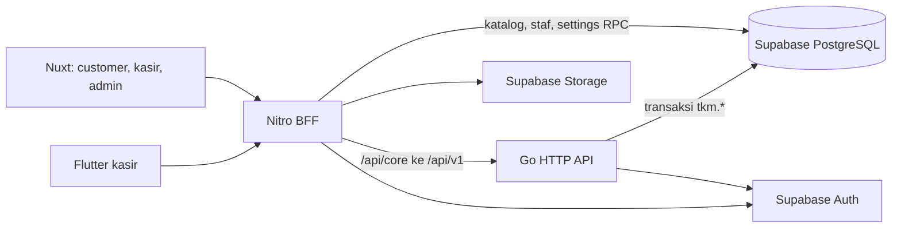

# Arsitektur implementasi TerasKayuManis

## Tujuan dan alur

Self-order untuk satu restoran: satu QR membuka `/menu`, customer membuat order
tanpa akun/meja, kasir review lalu claim, input/pembayaran manual pada POS, kemudian
forward. Lihat [kontrak bisnis](../docs/self-order-pos-flow.md).

PostgreSQL adalah sumber status/harga. REST membaca dan memutasi. Event/polling
hanya memberitahu perubahan; menerima notifikasi tidak mengubah order.

## Batas komponen

| Komponen | Tanggung jawab |
| --- | --- |
| Nuxt/Vue | Customer menu/cart/tracking, antrean kasir, admin web |
| Nitro | Same-origin proxy allowlist, staf/katalog/settings, batas unggahan, CSP |
| Go | Bentuk request, verifikasi Supabase user, role/status/version, query/transaksi |
| PostgreSQL | Pricing, idempotency, row lock, expected version, history/audit/outbox |
| Flutter | Sesi terenkripsi, cache revision, detail terarah, intent retry dan UI |
| Android watcher | Poll baca memakai lease khusus, single-flight dan backoff |
| Backup worker | Ekspor DB/media, enkripsi, offsite, bukti restore |

## Integritas transaksi

- Checkout mengirim IDs/jumlah/pilihan, bukan total. Server menghitung rupiah integer.
- Key checkout dan hash capability customer disimpan bersama order. Retry memakai
  key/token/payload identik; snapshot nama/harga menjaga riwayat.
- Review hanya pending belum expired dan versi cocok. Review tidak memperpanjang
  deadline 15 menit. `reviewed_version` harus sama sebelum claim.
- Claim mengunci order dan menetapkan satu kasir. Pengambilalihan admin memerlukan
  alasan. Forward hanya pemilik claim dan memerlukan pernyataan input/bayar POS.
- `forwarded` tidak membuat `payments`. `confirmed/completed/payments` lama adalah
  riwayat; endpoint pembayaran/completion lama mengembalikan 410.
- Status/history/outbox/audit ditulis dalam transaksi yang sama. Audit historis
  menyimpan nama/peran saat kejadian.

## Hak akses

Customer membaca order dengan `X-Order-Token` yang hash-nya cocok; nomor/UUID saja
tidak cukup. Staf memiliki Supabase session, profil aktif, role yang diizinkan dan
session_version cocok. Nitro menggunakan service key privat; Go memakai role DB
runtime terbatas tanpa hak katalog/identitas/DDL. Lihat [peran staf](../docs/staff-roles.md).

Lease notifikasi 0020 hanya untuk sync, TTL 5 jam 30 menit, maksimal lima perangkat
aktif per staf; native Android tidak memiliki token Supabase. Sesi dicabut/disabled
menolak lease. Logout offline tidak menjamin revoke server instan, sehingga TTL
dan izin baca terbatas tetap penting.

## Sinkronisasi dan performa

Vercel memakai revision DB dan budget per IP/identity. Browser/mobile mengambil
snapshot saat berubah atau rekonsiliasi berkala. Mobile dapat meminta summary
queue, date filter server dalam WIB, dan detail satu order. Cache dibatasi serta
diikat akun; intent yang belum pasti disimpan sebelum POST.

Go persisten menyediakan WSS/outbox untuk satu instance. Publikasi lokal bukan
jaminan delivery/ACK atau distribusi multi-instance; REST reconciliation tetap
wajib. Batas lane persisten 300 request/menit bersifat per proses dan perlu
evaluasi sebelum memilih deployment persisten untuk beban besar.

## Scope yang belum ada

Integrasi API POS, payment gateway, QRIS online, inventory bahan baku, offline
mutation queue, printer langsung, KDS, FCM/APNs dan multi-tenant bukan fitur aktif.
Build iOS, signing produksi, benchmark FPS/soak perangkat dan hosted load test
memerlukan bukti tersendiri. [Production readiness](../docs/production-readiness.md)
menjadi acuan rilis, bukan dokumen rancangan lama.
